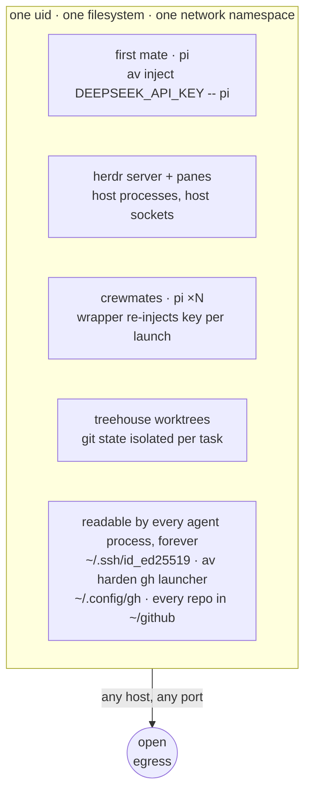
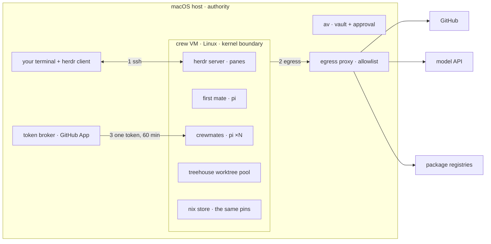
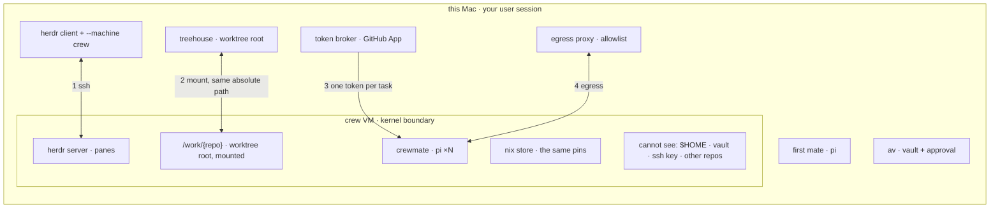

# Sandbox the crew: a Linux VM for computation, the Mac for authority

**Status:** plan, not implemented
**Date:** 2026-11-20
**Subject:** `agentic-dev-env` @ `5d2be4a` + working tree

Every claim below was checked against this tree and this machine on 2026-11-20. Section
[How to verify this plan](#how-to-verify-this-plan) carries the commands and their literal
output, so a reader can re-run them and disagree with the document rather than with me.

---

## One-sentence answer

Move the crewmates into a Lima Linux VM: herdr panes inside the guest, one shared worktree
root as the only host path they can see, one proxied egress path, and an ephemeral
credential minted per task. The Mac keeps the first mate, the vault, the allowlist, the
token broker and the repo the pins are authoritative in.

**The cost, stated up front.** The first mate still runs as you, with your network and your
hardened `gh` token. The boundary covers the processes that execute untrusted repo content,
which is where the exposure actually is. Closing the first mate too is Shape A in
[Two shapes](#two-shapes-and-where-the-boundary-stops); it stays a later, separable move
because phases 1 and 2 are identical for both.

**Settled:** crewmates only; ephemeral per-task model key.
**Open:** GitHub authority (App tokens vs PAT); whether Swift/macOS work is crew work.
Neither open item blocks phases 1–3.

---

## Where the agents run today



`mate` is, today, `av inject +DEEPSEEK_API_KEY -- env FM_BACKEND=herdr pi`, and the crewmate
wrapper at `home/.local/bin/pi` re-runs itself under `av inject` so a pane holds the key for
its own lifetime. Both are per-launch, neither is a boundary.

### What worktrees already buy

Two crewmates never fight over a branch or an index. That is git-state isolation, and it
works. Nothing here changes it, and the same treehouse pool moves inside the new boundary.

### What they do not buy

A worktree is a directory on your disk. The process in it still reads your keys, your other
repos and the network. The gap is blast radius, not branches.

### The four claims the plan must close

| #   | Today, a crewmate can                    | Because                                          | Evidence in this tree                        |
| --- | ---------------------------------------- | ------------------------------------------------ | -------------------------------------------- |
| 1   | read and write anything under `$HOME`    | it runs as your uid                              | `home.nix`, `home/.local/bin/pi`             |
| 2   | exfiltrate to any host                   | no egress policy exists below the OS             | no firewall/allowlist in `configuration.nix` |
| 3   | push, open and merge PRs with your token | `av harden gh` gates the command, not the caller | `configuration.nix`, README manual step 5    |
| 4   | hold the model key in its environment    | the wrapper injects per launch, into `env`       | `home/.local/bin/pi`                         |

The trigger is not a malicious crewmate. It is a prompt injection in a README, an issue
body, a test fixture or a dependency's output, executed inside a tool loop that already has
all four.

---

## Two shapes, and where the boundary stops

### Shape A · the whole fleet in the VM _(not chosen)_



The guest can name exactly three things it does not own: the host's sshd (panes), the host's
proxy port (egress) and the token broker's output. It cannot mount the host, cannot read the
vault, and cannot open a socket to anything the allowlist does not name.

### Shape B · crewmates in the VM, the first mate on the Mac _(chosen)_



The boundary is the guest kernel, and the diagram is honest about that: the first mate sits
outside it while sharing your uid, your network and your token. One host path crosses — the
treehouse pool root, at the same absolute path on both sides, so firstmate needs no
translation — and nothing else does.

### What crosses, and for how long

| Crossing                      | Direction               | Mechanism                                        | Lifetime       | Why it is not more                              |
| ----------------------------- | ----------------------- | ------------------------------------------------ | -------------- | ----------------------------------------------- |
| Pane rendering                | host → guest            | `ssh` · `herdr --machine crew`                   | attach session | transport only; the host runs no worker process |
| Worktree access               | host ↔ guest            | one virtiofs mount of the pool root, same path   | VM lifetime    | the only host path; `$HOME` stays outside       |
| Egress                        | guest → host → internet | nftables default-deny → CONNECT proxy, allowlist | connection     | one port, one policy file, no direct route      |
| GitHub authority              | host → guest            | `GH_TOKEN` from a GitHub App installation token  | 60 min         | one repo, `contents` + `pull_requests` only     |
| Model key                     | host → guest            | handed to the pane at spawn, never written       | task           | dies with the pane; no `av` in the guest        |
| Your files, vault, ssh, repos | none                    | —                                                | —              | no mount, no agent forwarding, no `av`          |

---

## Decision A: which runtime

The unit of isolation decides the answer. A crew needs a kernel boundary, an enforceable
egress policy, and a server the host can attach to. A per-task job needs none of that.

| Option                                  | Boundary                    | Egress control              | Human attach             | Fleet state        | Cost here                          | Verdict  |
| --------------------------------------- | --------------------------- | --------------------------- | ------------------------ | ------------------ | ---------------------------------- | -------- |
| **Lima 2.1.3** (`nixpkgs`, `vz` driver) | full Linux kernel VM        | nftables, default deny      | `ssh` → `herdr --remote` | persistent disk    | 8 GiB resident, ~10 GiB disk       | **crew** |
| Apple `container` 1.7.1                 | one microVM per container   | no first-class allowlist    | `exec` only, no ssh      | container lifetime | ~1 s start, nothing idle           | per task |
| Colima / Docker Desktop                 | Linux VM                    | host firewall still needed  | ssh possible             | VM                 | daemon, licensing, not declarative | no       |
| macOS `sandbox-exec`                    | none: same kernel, same uid | per-operation, not per-host | n/a                      | host               | cheap to write, cannot be trusted  | no       |

**Recommended: Lima now, Apple `container` later.** Lima gives what a persistent crew needs
and nothing it does not: a real kernel to put nftables in, sshd so `herdr --remote` works, a
disk that survives a reboot, and one `nixpkgs`-pinned binary. Apple's `container` is better
at the job it is for — a fresh kernel per task — and becomes phase 6, where no human attaches
and nothing persists.

**Rejected, with reasons.** `sandbox-exec` is a policy language over the same kernel, with no
per-hostname network control; it is a speed bump, not a boundary. Docker Desktop or Colima
adds a daemon and a licence to get a worse VM than Lima, and neither is a flake input.

---

## Decision B: crewmates only, and what that costs

Chosen: the first mate stays on the Mac; crewmates, their panes and their worktrees run in
the VM. The naive version of that is blocked upstream, by firstmate's own contract:

> Firstmate does not support placing an individual worker remotely or failing a remote route
> over to a local replacement.
> — `~/firstmate/docs/remote-secondmates.md`

The reason is concrete: the herdr backend selects a _local_ client, and treehouse returns
host directories whose absolute paths firstmate then reads and writes. So "crewmates only"
needs three pieces, each a seam this repo already knows how to build.

**1 · Pane targeting.** Every firstmate → herdr call must land on the guest's server.
`herdr --machine <label> <cmd>` already exists, so the seam is a PATH shim in `~/.local/bin`
— the same trick as the pi wrapper — with a knob in the fork's `bin/backends/herdr.sh` if
the shim cannot cover every call.

**2 · One shared path.** Firstmate reads the worktree it dispatched, so the treehouse pool
root is the single host path mounted into the guest — at the same absolute path, so no
translation exists anywhere, and `$HOME` stays outside.

**3 · Spawn-time credentials.** A pane's `pi` no longer has `av`. The guest wrapper receives
the ephemeral model key and the task token from the host at spawn, and holds them only for
its own lifetime.

### What this buys

Untrusted repo content executes in a kernel that cannot see `$HOME`, cannot reach the vault,
cannot open a socket the allowlist does not name, and holds no credential that outlives its
task. The worktree it may corrupt is the one it owns.

### What it does not buy

The first mate still runs as you, with your network and your hardened `gh` token, and still
reads untrusted issue text. A first-mate compromise has today's blast radius. Shape A is the
same work plus moving firstmate in, and it stays available as a later step.

> The first card is a spike, not an estimate: if the shim covers every adapter call it is
> days; if it does not, the fork grows a transport knob and the estimate moves with it.

---

## The seven phases, each with a gate

Each phase ends in a state that can be checked by a script, and the check is the same script
every later phase re-runs. Nothing advances on a green agent report.

### Phase 0 · Baseline: write the gap down — ½ day

From inside a crewmate pane today, record what is reachable: `ls ~/.ssh`,
`gh auth status`, `curl` to a random host, `av list`. This is the oracle, not a deliverable.

**Gate:** the transcript exists and every later phase is checked against it.

### Phase 1 · The box: a VM with no way in and one way out — 1–2 days

`nix/crew-sandbox/lima.yaml` (`vz`, 6 cpu, 8 GiB, sparse 30 GiB, `mounts: []` — the pool root
is the one mount phase 3 adds — no port forwards, no agent forwarding),
`crew up|down|status`, nftables default-deny, the host proxy.

**Gate:** `uname` is Linux · `ls /Users` fails · `mount` shows no virtiofs or 9p ·
`curl https://example.com` fails · the proxy port answers · DNS resolves.

### Phase 2 · The toolchain: same pins, different OS — 2–3 days

Nix inside the guest, then one home-manager module — `nix/crew-sandbox/guest.nix` —
importing `tools.nix`, `crew-tools.nix`, the pi package and herdr. Herdr gets a pin of its
own: the two release builders currently hardcode `kunchenguid/<name>`.

**Gate:** every tool resolves under `/nix/store` · `pi --version` equals the host's · a clone
through the proxy works · `nix-store --verify` is clean.

### Phase 3 · Panes move; the first mate does not — 2–3 days

The herdr target shim, the pool root mounted at its own absolute path, and the guest's
credential handoff at spawn. Firstmate stays where it is; only the pane server and the worker
process move.

**Gate:** a dispatched task's pane runs in the guest while `ps` on the host shows no worker
`pi` · firstmate reads and writes the worktree without noticing the mount · the pane is
visible from the host with live agent state · reconnect works after a guest reboot.

### Phase 4 · Authority: tokens out, broker in — 3–5 days

A GitHub App on the host mints an installation token per task (one repo, `contents` +
`pull_requests`, 60 min). The model key becomes per-task. `av`, the ssh key and
`~/.config/gh` are simply absent from the guest.

**Gate:** a token pushes to its repo and is refused on any other · it reads no org secret ·
it expires · `ssh -T git@github.com` fails · killing the proxy stops model traffic.

### Phase 5 · Adversarial proof — 1 day

A red-team script run as a crewmate, simulating a prompt injection: read `/Users`, dump
`env`, POST elsewhere, push to `main`, push to another repo, reach host services on
`192.168.5.2`. Six attempts, six recorded failures.

**Gate:** all six fail with evidence, and the evidence is what the ADR cites.

### Phase 6 · Optional: a microVM per untrusted task — later

Apple `container` with an image built from the same pins, used by no-mistakes verification
and by review of untrusted PRs. Fresh kernel, nothing persists, no human attaches. This is
where the runtime in Decision A earns its keep a second time.

> Two weeks of work end to end. Phases 1–3 are reversible: delete the VM and the host is
> exactly as it is today, because nothing host-side moved.

---

## The check is the deliverable

`nix/crew-sandbox/check.sh` takes a phase and runs named assertions, in the same spirit as
`.githooks/check`: one line per assertion, a non-zero exit on any failure, no hidden passes.
Phases add assertions; none are removed.

| Phase | Assertion                                               | Proves                               |
| ----- | ------------------------------------------------------- | ------------------------------------ |
| 1     | `mount` lists no virtiofs or 9p entry                   | no host filesystem in the guest yet  |
| 1     | `curl -sS --max-time 5 https://example.com` fails       | default-deny egress                  |
| 1     | `http_proxy` reachable, everything else refused         | one way out                          |
| 2     | `command -v pi herdr treehouse` → `/nix/store`          | pins, not installers                 |
| 2     | `pi --version` equals the host's                        | same harness both sides              |
| 3     | exactly one mount, at the pool root's own path          | the single shared path, and no other |
| 3     | host: no herdr server; every pane pid is a guest pid    | panes moved, the first mate did not  |
| 3     | `herdr --machine crew` answers after a reboot           | the human loop survives              |
| 4     | `env` has no key outside `GH_TOKEN`, `DEEPSEEK_API_KEY` | no ambient credential                |
| 4     | token push to a sibling repo is refused                 | scope, not trust                     |
| 5     | red-team: 6/6 blocked, transcript kept                  | containment, adversarially           |

---

## Risks and failure modes

| Risk                         | What happens                                                  | Mitigation                                                                                 |
| ---------------------------- | ------------------------------------------------------------- | ------------------------------------------------------------------------------------------ |
| Host disk                    | `/` has under 20 GiB free; a guest with a Nix store wants ~10 | sparse 30 GiB image, weekly GC, free host space first. A prerequisite, not a nice-to-have. |
| Proxy down                   | every model call stalls                                       | fail closed is correct; `crew status` names which of VM, proxy, herdr is unhealthy         |
| herdr protocol skew          | `protocol_mismatch` on remote operations                      | pin host and guest to one herdr release, not brew-latest on one side                       |
| The shim is a seam           | an adapter call that bypasses it puts a pane back on the Mac  | phase 3 asserts every pane is a guest process; the fork knob is the fallback               |
| Guest lost or deleted        | panes die mid-task                                            | worktrees live on the host, so the work survives; `crew up` reprovisions in under a minute |
| The token is still authority | a compromised crewmate opens a malicious PR in one repo       | 60-minute scope, PR review, no merge rights. The boundary bounds it; it does not erase it  |
| 8 GiB always reserved        | the Mac gets tight under Xcode or a browser                   | `crew down` when idle; the disk keeps the pane state                                       |

---

## The numbers

| Figure        | Value         | Where it comes from                                                                                  |
| ------------- | ------------- | ---------------------------------------------------------------------------------------------------- |
| Guest memory  | 8 of 16 GiB   | firstmate-era Node agents run ~300 MB each; two to four of them plus build headroom. The Mac keeps 8 |
| Guest disk    | 30 GiB sparse | 2 base + ~5 nix store + ~3 repos. Only what is written is allocated; the cap is the guard            |
| Cold boot     | 3–8 s         | `vz` boot to ssh; `crew up` on a live VM answers in under half a second                              |
| Proxy latency | < 1 ms        | loopback CONNECT per request; model payloads dominate, the proxy is noise                            |

---

## What changes in the repo

| Path                          | Change                                                                                                                           | Why the seam is there                                   |
| ----------------------------- | -------------------------------------------------------------------------------------------------------------------------------- | ------------------------------------------------------- |
| `nix/crew-sandbox/`           | new: `lima.yaml` (one mount, no others), `guest.nix`, `provision.sh`, `allowlist.txt`, `proxy`, `token-broker`, `check.sh`       | one seam per concern, as `nix/crew-tools` already is    |
| `crew-sandbox.nix`            | new: the host-side package set (lima, proxy), mirroring `crew-tools.nix`                                                         | keeps `tools.nix` CI-small                              |
| `nix/crew-tools/builders.nix` | give `releaseBinary` an `owner` argument                                                                                         | herdr is `herdrdev/herdr`, not `kunchenguid`            |
| `nix/crew-tools/pins.nix`     | add `herdr` per-system hashes                                                                                                    | host and guest run one release                          |
| `home/.local/bin/herdr`       | new: shim that adds `--machine crew`                                                                                             | firstmate's local client calls land on the guest server |
| `home.nix`                    | `mate` → `crew mate`; link `~/.local/bin/crew` and the herdr shim                                                                | the alias is the one entry point                        |
| `rebuild.sh`                  | no longer needs to own the fleet tree on the host                                                                                | the host stops hosting the panes                        |
| `README.md`, `GLOSSARY.md`    | a Sandbox section; terms: crew VM, egress proxy, task token                                                                      | terms are defined in one place                          |
| `docs/adr/0010`–`0014`        | sandbox is a VM · egress is one proxy · authority is brokered · toolchain from the same pins · macOS-only work stays on the host | one record per non-obvious decision                     |

### Deliberately unchanged

- `identity.nix` — the guest has its own user; the host identity is not shared.
- The host's link table, `tools.nix`, and the eight pinned crew tools.
- `update.sh` stays host-only; the guest may rewrite its copy and gains nothing.
- The pi-only harness, the vault policy, the 14-day pin gate.

### Migration, not a flag day

Phases 1–2 leave the host working exactly as now. Phase 3's switch is the herdr shim, which
is one file to delete; nothing gains a host credential it did not already have until phase 4,
and the old path stays documented until the adversarial check passes.

---

## Decisions

Two are settled and the plan is written around them. Two are open, and neither blocks phases
1–3.

| Decision                  | State                             | What it changes                                                                                                                               |
| ------------------------- | --------------------------------- | --------------------------------------------------------------------------------------------------------------------------------------------- |
| Which agents move         | **decided** — crewmates only      | section [Decision B](#decision-b-crewmates-only-and-what-that-costs): a herdr target shim, one mounted pool root, broker-supplied credentials |
| Where the model key lives | **decided** — ephemeral, per task | handed to the pane at spawn and never written; proxy-side injection stays a later option                                                      |
| GitHub authority          | **open**                          | App installation tokens (one repo, 60 min) or a fine-grained PAT. Phase 4 is the first thing that needs the answer                            |
| macOS-only work           | **open**                          | whether Swift tasks are crew work at all. Nothing in phases 1–3 depends on it                                                                 |

Also fixed: Lima as the runtime, and an Ubuntu LTS guest plus Nix rather than a NixOS image,
because generating a Linux image needs a Linux builder this Mac does not have. The
declarative surface is unaffected either way: it is the home-manager module.

---

## What this plan does not claim

- It does not stop a scoped token from opening a malicious PR in its one repo. Review is the
  control there.
- It does not sandbox your own shell or editor. Your session is the authority by design.
- It does not make model traffic private from the provider; that is a provider property, not
  a boundary here.
- It does not remove the need for `av scan`; the host keeps its findings either way.

---

## How to verify this plan

Run from the repo root on this machine. Observed output was captured on 2026-11-20.

**1. No container runtime is installed yet** — this plan installs the first one.

```console
$ for c in limactl docker podman container colima orbctl vfkit; do
    printf '%s:%s ' "$c" "$(command -v $c 2>/dev/null || echo none)"; done
limactl:none docker:none podman:none container:none colima:none orbctl:none vfkit:none
```

**2. Lima is already in the pinned nixpkgs; herdr is not.** Lima needs no new flake input.
Herdr needs a `releaseBinary` pin, and the builder currently hardcodes `kunchenguid/`, which
is why phase 2 changes `builders.nix`.

```console
$ nix eval --raw "github:NixOS/nixpkgs/f4244ef33645badc8157562b5e80748929b396c2#legacyPackages.aarch64-darwin.lima.name"
lima-2.1.3

$ nix eval --raw "github:NixOS/nixpkgs/f4244ef33645badc8157562b5e80748929b396c2#legacyPackages.aarch64-darwin.herdr.name"
error: flake '…' does not provide attribute '…herdr.name'
       Did you mean one of feedr, herbe, herqq, hexd or serd?
```

**3. The harness already builds for Linux**, so the guest runs the same pi as the host.

```console
$ nix eval --raw "github:earendil-works/pi/b4afdddf44e059c67ccf5097e5317d913521b470#packages.aarch64-linux.default.name"
pi-1.5.2
```

**4. pi has no DeepSeek base-URL knob**, which is why the model key stays ephemeral in the
guest instead of being held proxy-side (see the open question in [Decisions](#decisions)).

```console
$ d=$(ls -d /nix/store/*-pi-1.5.2 | head -1)
$ grep -rhoE 'DEEPSEEK_[A-Z_]+' "$d/lib" | sort -u
DEEPSEEK_API_KEY DEEPSEEK_CLASSIFIER_MODELS DEEPSEEK_IMAGE_MODELS DEEPSEEK_MODELS
$ grep -rq 'DEEPSEEK_BASE_URL' "$d/lib" && echo present || echo absent
absent
```

**5. herdr already has the remote-machine machinery** the shim in phase 3 depends on.

```console
$ herdr --version
herdr 0.9.5
$ herdr machine --help | head -3
Manage saved SSH machines

Usage: herdr machine [COMMAND]
```

**6. The vault offers narrower channels than an env var**, which is what a broker would use.

```console
$ av inject --help | head -6
Usage: av inject [--replace-existing-env] [--allow-missing-keys] +KEY [+KEY...] [--] COMMAND [args...]
       av inject [--replace-existing-env] [--allow-missing-keys] -- COMMAND [args...]
       av inject --mode=fd +KEY:FD [+KEY:FD...] -- COMMAND [args...]
…FD mode delivers each Secret through an anonymous pipe at FD (3 or higher),
requires Approval, and removes the named variables from COMMAND's environment.
$ av --help | grep -E 'av (proxy|git)'
  $ av proxy +KEY... [--] <command>     # proxy secret references for a command
  $ av git <clone|fetch|pull|push> <URL>  # protected GitHub HTTPS, main branch
```

**7. The upstream contract that shapes Decision B.**

```console
$ grep -n -A1 'does not support placing an individual worker' ~/firstmate/docs/remote-secondmates.md
Firstmate does not support placing an individual worker remotely or failing a remote route
over to a local replacement.
```

**8. The headroom prerequisite.**

```console
$ df -h / | tail -1
/dev/disk3s1s1   460Gi    18Gi    20Gi    48%    490k  205M    0%   /
$ uname -srm
Darwin 27.3.0 arm64
```

The free figure moves as the machine is used; the constraint is that it must clear roughly
10 GiB before phase 1, and that is the one item on this page that can block the work
regardless of design.

---

## Export notes

- This file is standalone. The two diagrams are Mermaid, which renders on GitHub, in VS Code
  with a Markdown preview that supports it, and in most Markdown viewers; the HTML twin keeps
  the hand-drawn versions.
  for a single portable file with local assets inlined.
- Nothing in this plan is implemented. No file outside `.lavish/` has changed.
