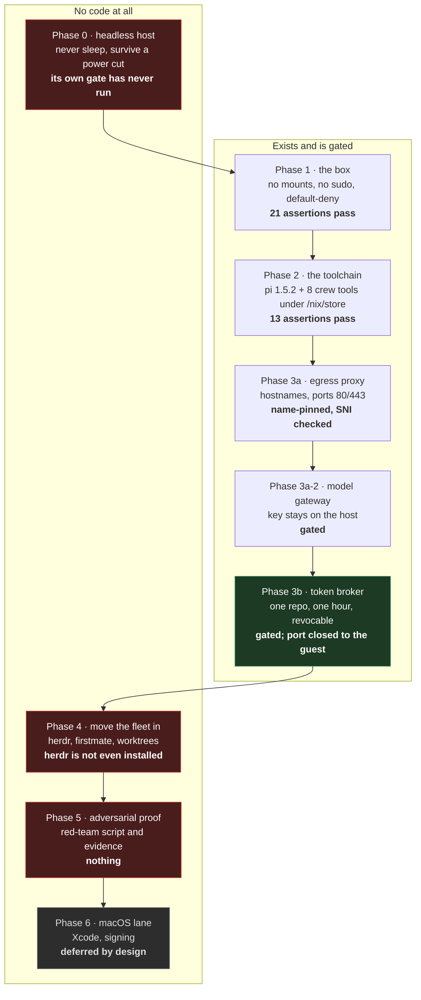

# Crew sandbox: plan vs. code review

Reviewed 21 November 2026. Plan: [`crew-sandbox-plan-revised.md`](.lavish/crew-sandbox-plan-revised.md).
Code: [`nix/crew-sandbox/`](nix/crew-sandbox) at `324c119`, plus the uncommitted `GLOSSARY.md` edit.

This is a review, not a rewrite. Every finding below was reproduced against the running
`crew` VM or read out of the source; nothing here is inferred from the plan alone.

---

## 1. How this was checked

Read: `default.nix`, `lima.yaml`, `guest.nix`, `crew-sandbox.sh`, `check.sh`, all six
`checks/*.sh`, `proxy.mjs`, `broker/broker.mjs`, `egress-allow`, `repos-allow`,
`guest/models.json`, `guest/settings.json`, `docs/README.md`, `docs/adr/0010`, `flake.nix`,
`home.nix`, `.githooks/check`, both CI workflows.

Ran against the live VM:

| Command                                                                          | Result                                                                                                                    |
| -------------------------------------------------------------------------------- | ------------------------------------------------------------------------------------------------------------------------- |
| `crew-sandbox check` (phase 1)                                                   | **pass**, 21 assertions                                                                                                   |
| `crew-sandbox check toolchain` (phase 2)                                         | **pass**, pi 1.5.2, all 8 crew tools under `/nix/store`                                                                   |
| `crew-sandbox check proxy`                                                       | **pass** after the `api.github.com` fix, including the new assertion                                                      |
| `proxy.mjs` with a dummy key + the real guest token, then `pi -p` from the guest | **pass**: request reached DeepSeek, got a real `401` for the dummy key, proxy logged `ALLOW model POST /chat/completions` |
| `git clone` through the proxy                                                    | **pass**: 55 884 files                                                                                                    |
| `curl -x proxy https://api.github.com/`                                          | **fail** before the fix, `403`; **pass** after, `200`                                                                     |
| `crew-sandbox check broker` with the ruleset                                     | **pass**: agent branch writable, default branch refused `409`, branch deleted, token revoked                              |
| the same gate with the ruleset deleted                                           | **fail**, on both the ruleset assertion and the default-branch write                                                      |
| `gh api .../branches/main/protection` before C0                                  | `404 Branch not protected`; rulesets `[]`                                                                                 |
| `crew-sandbox kill` with an instrumented broker                                  | **pass**: revoke arrives at `VM=Stopped`                                                                                  |
| the same kill with `limactl stop` forced to fail                                 | revoke still fires, exit 1, reported as "revoking anyway"                                                                 |
| guest → host `:3129` with `--noproxy`                                            | **unreachable** after the C1 fix (timeout); was reachable, and `/token` reads no credential                               |
| agent pre-owns `/tmp/crew-root-checks.sh`, then gate runs                        | **gate exits 23**, planted script does _not_ run as root                                                                  |
| `curl -H 'Host: example.com' http://registry.npmjs.org/` via the proxy           | **fail** before C4 (served `example.com`); **pass** after (answered by `registry.npmjs.org`)                              |
| `curl --connect-to example.com:443:registry.npmjs.org:443` via the proxy         | **fail** before C4 (`200`, `example.com`); **pass** after (tunnel refused, `sni-mismatch`)                                |
| crafted ClientHello with an overlong extensions field                            | **killed the proxy** before C4 (`ERR_OUT_OF_RANGE`); **denied** after, proxy still serving                                |
| `prettier --check` on both `.mjs`                                                | **fail**, and the hook never sees them                                                                                    |
| `nix eval .#packages.aarch64-darwin.crew-sandbox`                                | resolves; no CI job ever builds it                                                                                        |

**Not run:** `check model` and `check broker`. They need `av` vault approval and a real GitHub
App key. Their _components_ were exercised by hand instead — the gateway with a dummy key and
the real guest token, the broker's route table by reading it and probing reachability — which
is why the findings below are about those components rather than the gate wrappers.

---

## 2. Verdict

The boundary that exists is real and it holds: no mounts, no sudo, default-deny egress,
no host credentials in the guest, and the model key genuinely stays on the host. That is
more than most agent sandboxes ever get to.

What is missing is the part that makes the boundary _authoritative_ rather than _advisory_.
Two edges are wrong in opposite directions: one door is too wide (the broker) and one is
shut that should be open (`api.github.com`). Phase 0 and Phase 4 — the two phases the plan
calls load-bearing — have no code at all.

|            | Count              |
| ---------- | ------------------ |
| Critical   | 5 (all fixed here) |
| High       | 4 (2 fixed here)   |
| Medium     | 9                  |
| Low / nits | 12                 |

**C0**, **C1**, **C2**, **C3** and **C4** were all fixed in this pass and verified against the
live repository and VM (C4 against a locally started proxy and the live CDNs it names). C1's
fix is the narrow one: the broker port is closed to the guest, so the minting path is
unreachable, but the broker still authenticates no caller. That is correct while it is an
operator tool on host loopback and becomes wrong the moment Phase 4 reopens the port — so
per-task auth is a Phase 4 prerequisite, not an optional hardening.

**H1** and **H2** were also fixed and verified in this pass, along with the `apply` bug that
H2's verification exposed. `check all` now runs every phase in one process and passed 79
assertions end to end (21 box, 13 toolchain, 9 proxy, 12 model, 24 broker), leaving no
listener behind. That count predates **C4**, which adds three assertions to `checks/proxy.sh`
and a parser selftest that `phase_proxy` runs first; the total needs re-measuring on the next
VM run.

### Phase coverage at a glance

The plan has six phases. This is what actually exists behind each one.



The plan's order of work puts Phase 0 first. Nothing behind it exists, so the power-cut test
the plan calls the gate cannot be attempted. Phase 3b is gated and now enforced at the
network layer: the gate proves the token is scoped, and the firewall no longer lets any
crewmate reach the broker (C1). What remains for 3b is per-task auth, which needs Phase 4's
spawn path.

---

## 3. Findings

### Critical

#### C0. The broker gate asserted the absence of branch protection — **fixed and verified**

`checks/broker.sh:84` PUT a file to the default branch with no `branch` parameter. That call
only succeeds when nothing protects `main`, so the gate passed **because** the human-merge
backstop the plan relies on did not exist. A `contents: write` token can push the default
branch and, with `pull_requests: write`, merge its own pull request, so "review is the
control" was not true of the system being gated.

Confirmed against the live throwaway repository before the fix:

```console
$ gh api repos/aditya-sathish-rao/crew-broker/branches/main/protection
{"message":"Branch not protected","status":"404"}
$ gh api repos/aditya-sathish-rao/crew-broker/rulesets
[]
```

**Fix applied**, in three parts:

1. [nix/crew-sandbox/checks/broker-ruleset.json](nix/crew-sandbox/checks/broker-ruleset.json)
   — one approving review, `dismiss_stale_reviews_on_push`, `require_last_push_approval`,
   resolved threads, `non_fast_forward`, `deletion`, and `bypass_actors: []` so the App is
   not exempt.
2. [`crew-sandbox ruleset <owner/repo>`](nix/crew-sandbox/crew-sandbox.sh) — applies it
   idempotently and prints the rules now in force.
3. The gate now writes only to an `agent/gate-*` branch and asserts the default branch
   **refuses** the same token, so a missing ruleset is its own named failure.

**Verified by removing the ruleset and rerunning.** The gate fails on both counts and names
the cause:

```console
FAIL  the default branch requires a pull request (got '')
      apply the pinned ruleset: crew-sandbox ruleset .../broker-ruleset.json
FAIL  the default branch refuses the token (it wrote main; the App is on the ruleset bypass list)
```

With the ruleset restored: `PASS the default branch refuses the token (409)`, gate exit 0,
and no residue — only `main` remains, the tree is empty, and the agent branch is deleted
before the token is revoked.

#### C3. `kill` revoked before stopping, leaving a mint window — **fixed and verified**

`crew-sandbox.sh:63-80` called `/revoke-all` and _then_ `limactl stop`. While C1 is open, any
crewmate can mint a token, so the gap between the sweep and the shutdown was a window in
which a fresh token could be issued after the revoke and outlive it. The kill switch would
report success while a live credential remained.

A second defect sat in the same block: `writeShellApplication` sets `errexit`, so a failing
`limactl stop` aborted the script **before** the revoke. "Revoke even if the stop fails" was
therefore violated by the language, not just by the ordering.

**Fix applied.** Stop first, revoke second, and catch the stop failure so it cannot skip the
revoke. Both halves now decide the exit status, because either one alone leaves a credential
alive.

**Verified two ways**, with an instrumented stand-in broker recording the VM's status at the
moment `/revoke-all` arrives:

```console
# healthy path
crew: VM stopped
crew: {"tasks":2,"revoked":2}
recorded: revoke-all at VM=Stopped

# stop forced to fail through a limactl shim
limactl: simulated stop failure
crew: the VM did not stop; revoking anyway
crew: {"tasks":2,"revoked":2}
KILL EXIT=1
```

The first line is the point: the revoke now always sees `Stopped`.

#### C1. The token broker is unauthenticated — **port closed, auth still missing**

The plan's central credential claim is _"a host-side broker mints a GitHub App installation
token per task."_ The broker is a host service that any crewmate can call itself.

**Evidence (as found).**

- [`lima.yaml:111`](nix/crew-sandbox/lima.yaml) allowed `ip daddr $gw tcp dport 3129 accept`
  — the guest firewall was explicitly configured to reach the broker.
- [`broker.mjs:237`](nix/crew-sandbox/broker/broker.mjs) binds `127.0.0.1:3129`, which Lima
  forwards to the guest gateway.
- [`broker.mjs:153`](nix/crew-sandbox/broker/broker.mjs) — the `/token` handler reads
  `task` and `repo`, checks `repos`, mints, and returns. It never reads an `Authorization`
  header. Confirmed by reading the handler: no credential check exists anywhere on the route.
- Reachability proven empirically: a stand-in listener on `127.0.0.1:3129` answered
  `GET /health` → `200` and `POST /token` → `200` from inside the guest with `--noproxy '*'`.

**Impact.** Every crewmate runs as the same `agent` user, so nothing distinguishes a
crewmate from the first mate. Any of them could mint a real installation token for any
repository in `repos-allow`, with no task binding and no first-mate involvement. The
per-task property was enforced by convention only. `POST /revoke-all` was equally open, so a
crewmate could also revoke the whole fleet's tokens at will.

**Fix applied (option 1 of the three below).** `3129` is gone from the output chain in
`lima.yaml`, and `checks/root.sh` now asserts 3128 is the only reachable port and that 3129
is closed. Verified against the live VM:

```console
$ limactl shell crew -- sudo -n -u agent -H bash -lc \
    'curl --noproxy "*" -sS -m 5 http://host.lima.internal:3129/health'
curl: (28) Connection timed out after 5004 milliseconds

$ limactl shell crew -- sudo -n nft list chain inet crew output
table inet crew {
  chain output {
    type filter hook output priority filter; policy drop;
    oif "lo" accept
    ct state established,related accept
    ip daddr 192.168.5.2 tcp dport 3128 accept
  }
}
```

`check box` reports `PASS  the token broker is not reachable from the guest`.

**What is still missing.** The port is closed, so the minting path is unreachable — but the
broker itself still authenticates no caller. That is fine while it is an operator tool on
host loopback, and it stops being fine the moment Phase 4 reopens the port. The remaining
work, in order of preference:

1. ~~**Close the port until the consumer exists.**~~ **Done.** Reopen it only in Phase 4,
   together with the spawn path that injects a per-task secret into the pane.
2. **Authenticate it.** At spawn, the host writes a random per-task secret into the pane's
   environment and registers it with the broker; `/token` requires
   `Authorization: Bearer <that secret>` and refuses a `repo` that does not match the
   secret's task. This is the plan's actual design and it is not implemented.
3. **Bind to a unix socket** in a directory the guest cannot reach, and have the host inject
   the path.

Do (2) in Phase 4, before the port is reopened. Also gate `/revoke-all` behind the same
credential.

#### C2. `api.github.com` is not in `egress-allow`, so the crew's GitHub API path is dead — **fixed and verified**

**Evidence (before the fix).**

```console
guest$ curl -x http://192.168.5.2:3128 https://api.github.com/
curl: (7) CONNECT tunnel failed, response 403
proxy: 2026-11-20T23:59:58.337Z DENY api.github.com:443
```

`egress-allow` named `github.com`, `.codeload.github.com`, `.raw.githubusercontent.com`,
`.release-assets.githubusercontent.com`, `.objects.githubusercontent.com` — and no
`api.github.com`. `git clone`/`git push` over `github.com:443` worked; the REST API did not.

**Impact.** `gh-axi` and `no-mistakes` are crew tools that talk to the REST API. Phase 4
moves the fleet in and Phase 5 expects crewmates to open pull requests. Push works; PRs,
reviews and issue reads do not. This is the exact class of failure that a phase gate should
have caught and did not (see H2).

**Fix applied.** One line in [`egress-allow`](nix/crew-sandbox/egress-allow), with its
reason, plus an assertion in [`checks/proxy.sh`](nix/crew-sandbox/checks/proxy.sh) so the
omission cannot come back:

```bash
code=$(curl -sS -m 15 -o /dev/null -w '%{http_code}' -x "$proxy" \
  https://api.github.com/ 2>/dev/null || echo 000)
if [[ "$code" != 000 && "$code" != 403 ]]; then
  pass "the GitHub API answers through the proxy (${code})"
else
  flunk "the GitHub API answers through the proxy (got ${code}); add api.github.com to egress-allow"
fi
```

**Verified** by rerunning the real gate against the live VM:

```console
ALLOW api.github.com:443 from 127.0.0.1
PASS  the GitHub API answers through the proxy (200)
```

Note that the assertion accepts any non-`000`/non-`403` answer. GitHub replies `200` to an
unauthenticated `GET /`, but a `401` would also mean the host was reached, which is the only
thing this gate is about.

#### C4. The allowlist named addresses, not hosts — **fixed and verified**

Reported as "the proxy forwards the guest's `Host` header on plain HTTP", which was true and
is the smaller half. Reproducing it showed the same hole on the TLS route, where no header is
visible at all, and that half was **not limited to wildcard entries**.

**Evidence (before the fix).** One allowlisted CDN address, one request:

```console
# plain HTTP: the guest chose which virtual host answered
$ curl -x http://127.0.0.1:3128 -H 'Host: example.com' http://registry.npmjs.org/
HTTP/1.1 200 OK
<title>Example Domain</title>

# TLS: CONNECT named the allowed host, the ClientHello named another
$ curl -x http://127.0.0.1:3128 \
    --connect-to example.com:443:registry.npmjs.org:443 https://example.com/
<html><head><title>Example Domain</title>
```

[`proxy.mjs:187-194`](nix/crew-sandbox/proxy.mjs) passed `req.headers` straight through, so
`Host` was the guest's. The `connect` handler
([`proxy.mjs:212`](nix/crew-sandbox/proxy.mjs)) validated the destination and then spliced
bytes, so the SNI inside the tunnel was never examined. `registry.npmjs.org` and
`example.com` both sit behind Cloudflare and were served from the same edge, so a single
allowlisted name reached an off-list site. The same works on Fastly with `cache.nixos.org`.

**Impact.** The allowlist is the entire egress boundary — the guest firewall admits nothing
else. If a name is not the control, the control is "the guest may reach any site that shares
a CDN address with an allowlisted host", which is most of the web. Any crewmate with `curl`
could reach arbitrary hosts, exfiltrate to an attacker, or fetch a payload, and every log
line would read `ALLOW registry.npmjs.org:80` while it did. Narrowing wildcards, as the
report suggested, does **not** fix it: the second repro above uses an exact hostname.

A third defect sat in the same area: the extension-length field of a ClientHello was trusted,
so a crafted handshake threw out of a socket handler and **killed the proxy process**
(`ERR_OUT_OF_RANGE`). A crewmate could take down the host's egress control at will.

**Fix applied**, in [`proxy.mjs`](nix/crew-sandbox/proxy.mjs):

1. **Plain HTTP:** the guest's `Host` is discarded and set from the destination
   (`headers.host = target.host`), the same way the model route already did.
2. **TLS:** `CONNECT` is TLS-only (port 443), and the proxy now reads the first flight, parses
   the ClientHello, and refuses the tunnel before forwarding a byte unless the `server_name`
   is exactly the name that was allowed. With that equality a wildcard grants its own
   subdomains and nothing else, so the CDN-widening effect is gone for every entry.
3. **Hardening:** header stripping is a helper shared by both routes, `Connection`-listed
   headers are removed, the extension block is bounded by the ClientHello body, and the parse
   is wrapped so a malformed flight costs one tunnel rather than the process. A stream is
   paused before its listener is detached, so nothing the client sends can be dropped between
   the handshake and the tunnel.

**Verified.** `--selftest` builds handshakes byte by byte and proves the parser offline, which
is what keeps this logic testable without a VM; `check proxy` now asserts both attacks and the
port-80 tunnel against real CDN hosts:

```console
selftest: ok   a named host -> {"status":"ok","sni":"registry.npmjs.org"}
selftest: ok   no server_name -> {"status":"ok","sni":null}
selftest: ok   an extension block past the end -> {"status":"no","reason":"extensions-overrun"}

PASS  an allowlisted host answers through the proxy
PASS  a spoofed Host header cannot retarget a plain-HTTP request
PASS  a tunnel whose SNI names another host is refused
PASS  CONNECT is refused on port 80
```

The three new assertions **fail against the pre-fix proxy** (`200` for the SNI retarget; a
spoofed `Host` changing the answer from `301 https://registry.npmjs.org/` to `200`; a `301`
through a port-80 tunnel), so they are real gates rather than restatements. Legitimate traffic
rechecked after the change: `git clone` of a GitHub repository, `curl` to the npm registry
over both HTTP and HTTPS, a Node TLS client, and the model gateway (no token → `401`, dummy
key → upstream `401`, spoofed `Host` still reaches DeepSeek). 480 random first flights and a
crafted `extensions-overrun` handshake all left the proxy running.

**Residual risk, stated rather than papered over.** A CONNECT proxy cannot see inside TLS.
The guarantee is now "only allowlisted hostnames", not "only their ordinary traffic": a client
that skips certificate validation can present an allowed SNI and a different `Host` inside
the tunnel. Closing that needs TLS termination in the proxy — the CA the plan originally
proposed and the code deliberately dropped. It is written down in
[docs/README.md](docs/README.md) next to the egress guarantees.

A note on method: this was verified against a locally started `proxy.mjs` and the real CDN
addresses the attack used, not against the VM (`limactl` is not on this host), so the
`check all` total in §2 has not been re-measured. The three assertions were run against both
the new and the pre-fix proxy through the same harness, which is the part that matters.

---

### High

#### H1. Gate scripts are copied into agent-writable `/tmp` and run as root — **fixed and verified**

[`check.sh:101`](nix/crew-sandbox/check.sh) did `limactl copy <script> crew:/tmp/...`
and then [`check.sh:161`](nix/crew-sandbox/check.sh) ran
`sudo -n bash /tmp/crew-root-checks.sh`. The destination was world-writable and the guest's
`agent` user could pre-create it.

**Evidence (before the fix).** With a regular file planted by `agent` at that exact path:

```console
rsync: [receiver] rename "/tmp/.crew-root-checks.sh.AGQmWG" -> "crew-root-checks.sh": Operation not permitted (1)
gate exit=23
GATEHIJACK absent
```

With a directory planted there: `mkstemp ... Permission denied (13)`, exit 23.

**Impact.** It **failed closed** — the planted script never executed, and a clean copy landed
as `crew:crew 644` which the agent could not rewrite. So it was not a live root escalation.
It was two real problems anyway:

1. **Denial.** A crewmate could make `crew-sandbox check` unusable exactly when the operator
   needed it to judge the box, and the output was an rsync error rather than a tampering
   signal. The operator read "infrastructure broke", not "the guest interfered".
2. **Latent escalation.** The moment anyone changed the copy to `--delete`, `cp`, or a
   `curl | bash`, the same agent-writable path became root code execution. The design should
   not depend on rsync's refusal to clobber.

**Fix, as implemented.** The gate stages into `/run/crew-gate`, created by the driver as
`root:crew 0775` on tmpfs. `limactl copy` runs as the admin account (`crew`), which is in the
group, so staging works; `agent` is not in `crew`, so it cannot write there at all. Each
script is copied to a dot-prefixed staging name and then `install -o root -g root -m 0755`'d
into place, so the account that staged it cannot rewrite what root is about to execute. A
failed copy is a named failure that prints rsync's own message, not a bare exit code.
`checks/root.sh` asserts the directory is root-owned.

**Verified against the live VM.** Every attack the finding described now fails at the
filesystem, before the gate runs:

```console
$ limactl shell crew -- sudo -n -u agent -H bash -c 'echo x > /run/crew-gate/crew-root-checks.sh'
bash: line 1: /run/crew-gate/crew-root-checks.sh: Permission denied
$ limactl shell crew -- sudo -n -u agent -H bash -c 'echo x > /run/crew-gate/.crew-root-checks.sh.new'
bash: line 1: /run/crew-gate/.crew-root-checks.sh.new: Permission denied
$ limactl shell crew -- sudo -n -u agent -H bash -c 'mkdir /run/crew-gate/crew-agent-checks.sh'
mkdir: Permission denied
$ limactl shell crew -- sudo -n -u agent -H bash -c 'mkdir -p /run/crew-gate'
mkdir: Permission denied
$ limactl shell crew -- sudo -n -u agent -H bash -c 'ln -s /home/agent/fake /run/crew-gate'
ln: failed to create symbolic link '/run/crew-gate': Permission denied
```

And tampering that root itself causes still reads as tampering, not as infrastructure:

```console
$ limactl shell crew -- sudo -n touch /run/crew-gate          # path is a file
FAIL  the gate could not create /run/crew-gate
      the guest may be interfering with the gate

$ limactl shell crew -- sudo -n mkdir /run/crew-gate/.crew-proxy-checks.sh.new
FAIL  the gate could not stage crew-proxy-checks.sh
      rsync: [receiver] mkstemp ".../.crew-proxy-checks.sh.new/..." failed: Permission denied (13)
      the guest may be interfering with the gate
```

`check box` now reports `PASS  the gate directory is owned by root (root:775)`.

#### H2. The phase gates do not compose — **fixed and verified**

`check model` started a keyed proxy but never ran `checks/proxy.sh`; only `phase == proxy`
copied it. `check toolchain` asserted nothing about egress. There was no `check all`.

**Impact.** An operator could run `check model`, see pass, and believe the boundary held —
while the allowlist was wrong (C2) and the broker was open (C1). Each gate was correct in
isolation and the combination is what ships.

**Fix, as implemented.** `check all` runs every phase in one process. `check model` now also
stages and runs `checks/proxy.sh` against the keyed proxy, so the allowlist is asserted by
the gate that proves the key stays home. Three composition bugs surfaced only once the phases
ran together, and all three are fixed:

1. **`phase_proxy` leaked its listener.** It started a keyless proxy and left it to the EXIT
   trap, so `check model` then refused to run with "port 3128 is already in use". Each phase
   now stops the service it started.
2. **`av inject` forks.** The tracked PID is the wrapper, not the process holding the port, so
   killing it orphaned a listener. `stop_service` now also stops whatever holds the port.
3. **A later phase overwrote `service_pid`.** The broker gate replaced the model gate's PID,
   so a failed model phase leaked its keyed proxy and the next run failed on a busy port.
   Cleanup now tracks every port the run started, not just the last one.

**Verified.** Repeated `check all` runs: 79 assertions, `all: pass`, and `lsof` shows 3128
and 3139 free afterwards. One run in the sequence failed at the model phase with "the vault
returned no DEEPSEEK_API_KEY" because the approval prompt was not answered in time — the gate
correctly refusing to proceed without the key, and, importantly, leaving no listener behind
when it did.

#### H2a. `crew-sandbox apply` was not idempotent on a fresh VM — **fixed and verified**

Found while verifying H2, because `check all` could not pass without a toolchain.

`useradd` writes stock `~/.bashrc` and `~/.profile`, and `home-manager switch` refuses to
clobber them, so `apply` aborted on a VM that had never had it run:

```console
Existing file '/home/agent/.bashrc' would be clobbered
Existing file '/home/agent/.profile' would be clobbered
```

`check toolchain` then failed on every line (`pi ... got 'none'`, all eight tools missing).
`apply` now passes `-b backup`, which moves the stock files aside. Verified: `apply` succeeds,
`check toolchain` passes all 13 assertions, and `check all` reaches `all: pass`.

#### H3. `nix-store --verify` is not an integrity check, and the agent owns the store

**Evidence.** `/nix` and `/nix/store` are `agent:agent 755`; `test -w /nix/store` succeeds.
[`checks/toolchain.sh:34`](nix/crew-sandbox/checks/toolchain.sh) runs
`nix-store --verify` without `--check-contents`.

**Impact.** "Every tool resolves under `/nix/store`" proves _location_, not _provenance_. A
crewmate can replace its own `pi`, `treehouse` or `no-mistakes` with anything, and the gate
still passes. The blast radius is bounded — it only compromises the guest, which is already
the untrusted side — but the docs claim a pinning guarantee the mechanism does not provide.

**Fix.** Either say plainly in `docs/README.md` that single-user Nix means the store is
agent-owned and the pins protect against _drift_, not _tampering_; or run
`nix-store --verify --check-contents` and accept the cost; or move to a root-owned store with
a daemon (which contradicts the "no root afterwards" choice and needs a real decision, not a
patch).

#### H4. Phase 0 and Phase 4 have no code

**Evidence.**

- No `pmset`, autologin, FileVault or never-sleep handling in `configuration.nix`,
  `home.nix` or `flake.nix`. Phase 0's own gate — cut power, come back — cannot be attempted.
- Guest has no `herdr`, no `gh`, no git identity (`git config --global user.email` → unset),
  and `~/agentic-dev-env` is **not a git repository** — it contains AppleDouble `._*` files,
  which means files were copied in by some earlier, unrecorded route.

**Impact.** The plan's order of work puts Phase 0 first and Phase 4 immediately after
authority. Neither exists. `check toolchain` passes while the fleet's actual runtime is
absent, so the gate reports readiness that is not there.

**Fix.** Decide Phase 0's shape: implement never-sleep and restart-after-power-failure in
`configuration.nix` (reproducible) or record it as explicit operator steps in the plan. For
Phase 4, add `herdr`, a git identity and a pinned `firstmate` to
[`guest.nix`](nix/crew-sandbox/guest.nix), then assert them in `checks/toolchain.sh` —
including a check that `herdr` runs.

---

### Medium

| #   | Finding                                                                                                                                                                                                                                               | Evidence                                                     | Fix                                                                                                                 |
| --- | ----------------------------------------------------------------------------------------------------------------------------------------------------------------------------------------------------------------------------------------------------- | ------------------------------------------------------------ | ------------------------------------------------------------------------------------------------------------------- |
| M1  | Nothing applies `guest.nix`. No `home-manager switch` appears anywhere in the repo or docs, so the guest toolchain exists only because someone ran it by hand.                                                                                        | `grep -rn "home-manager switch"` → nothing                   | A `crew-sandbox apply` subcommand that runs the pinned generation, plus a check that the active generation matches. |
| M2  | `.githooks/check` never looks at `.mjs`. `file_type()` has no `*.mjs` case, so `proxy.mjs` and `broker.mjs` are never formatted or linted.                                                                                                            | `prettier --check` fails on both; hook prints nothing        | Add `mjs` to the classifier, format, and add `node --check` for syntax.                                             |
| M3  | No CI builds `crew-sandbox`. `crew-tools.yml` builds `.#crew-tools`; `checks.yml` evaluates the darwin config, which does not include the package.                                                                                                    | `grep -rn crew-sandbox .github/` → nothing                   | Add `nix build --impure .#crew-sandbox --no-link` to a job.                                                         |
| M4  | Broker port defaults disagree: `check.sh` 3139, `crew-sandbox.sh`/`broker.mjs`/`lima.yaml` 3129. Deliberate (the gate avoids clobbering a running broker) but undocumented, and `kill` cannot revoke a gate-issued token.                             | `check.sh:61` vs `crew-sandbox.sh:64`                        | One constant, or a comment that says why the gate differs.                                                          |
| M5  | `lsof` is not in `runtimeInputs`, but both host scripts call it. It lives in `/usr/sbin`.                                                                                                                                                             | `grep lsof`; `runtimeInputs` has lima/coreutils/curl/jq/node | Add `pkgs.lsof` to both `writeShellApplication` blocks.                                                             |
| M6  | `no_proxy=host.lima.internal` is required for the gateway, because it shares port 3128 with the CONNECT proxy. Any client that ignores `no_proxy` will `CONNECT host.lima.internal:3128` and be denied.                                               | `lima.yaml:118`, `guest/models.json:5`                       | Give the gateway its own port (e.g. 3130) so proxy and gateway are never the same listener.                         |
| M7  | `broker.sh` can pass for the wrong reason: the "other repo" is `${owner}/agentic-dev-env`, which is not in `repos-allow` and may not have the App installed, so a 404 means "not installed", not "scoped token refused". Unchanged by the C0 rewrite. | `checks/broker.sh:106`                                       | Assert the repo is installed first, then require `403` specifically.                                                |
| M8  | The model token is `0644 root:root` — readable by every crewmate by design so `pi` can read it — and it never rotates. GitHub tokens cross the virtual network in plaintext HTTP.                                                                     | `stat /etc/crew-model-token` → `root:root 644`               | Rotate on recreate; document that the token is guest-readable on purpose and that it only opens the host gateway.   |
| M9  | `revoke-all` is sequential and can exceed `kill`'s 30 s client timeout, reporting failure while still revoking.                                                                                                                                       | `broker.mjs:205`, `crew-sandbox.sh:67`                       | `Promise.allSettled`, or return `202` and revoke in the background.                                                 |

### Low / nits

- [`guest.nix:8`](nix/crew-sandbox/guest.nix) promises `profileExtra` for login shells but
  only sets `initExtra`; `environment` also has a trailing blank line. It works because
  home-manager's profile handles login shells — the comment is stale.
- [`checks/model.sh:107`](nix/crew-sandbox/checks/model.sh) probes
  `https://api.deepseek.com/models` through the proxy environment, so it tests the allowlist,
  not the firewall. Right result, wrong label.
- `model.sh` hashes only the gate process's `env`. `/proc` has no `hidepid`, so with a fleet
  running, another process's environment is readable and unexamined.
- [`checks/agent.sh`](nix/crew-sandbox/checks/agent.sh) never asserts that the **broker**
  port is unreachable (which is how C1 stayed invisible) and never asserts `/nix/store` is
  not writable (H3).
- [`broker.mjs:124`](nix/crew-sandbox/broker/broker.mjs) keeps buffering after the 8 KiB
  rejection and does not destroy the socket.
- `broker.mjs` `issued` never expires, so a long-lived broker grows and refuses re-mints.
- [`proxy.mjs`](nix/crew-sandbox/proxy.mjs) still forwards the guest's headers through a
  denylist (now shared by both routes, and `Host` is no longer among them). An allowlist of
  the headers a package manager actually needs would be tighter still.
- `egress-allow` names `.herdr.dev` and `.pi.dev`, but `pi` comes from Nix and `herdr` is not
  installed. Speculative entries widen the surface; C4 removed the CDN-widening effect, not
  the fact that they are unused.
- `repos-allow` holds only `crew-broker`, while the broker gate's own "other repo" default
  assumes `agentic-dev-env`.
- `lima.yaml` asks for a 30 GiB disk on a host with 20 GiB free; `~/.lima/crew` is already
  11 G.
- `.lavish/*.md` and the 60 KB HTML plans are tracked in git.
- `crew-sandbox.sh` has no `set -euo pipefail`, unlike `check.sh`.

---

## 4. Plan vs. code

### In the plan, absent from the code

| Plan item                                                      | State                                                                                 |
| -------------------------------------------------------------- | ------------------------------------------------------------------------------------- |
| Phase 0: headless host, power-cut gate                         | nothing                                                                               |
| Phase 4: herdr, firstmate fork+pin, worktree pool in the guest | nothing; `herdr` not installed                                                        |
| Phase 5: red-team script and recorded evidence                 | nothing                                                                               |
| Token bound to the task that asked                             | not implemented (C1)                                                                  |
| Per-task caps: tokens, iterations, wall-clock                  | nothing                                                                               |
| Daily budget at the proxy; provider spend cap                  | nothing                                                                               |
| Remote kill that revokes and stops                             | `kill` exists; the revoke half cannot reach a gate-issued token (M4)                  |
| Health command naming VM / proxy / herdr                       | nothing                                                                               |
| Recovery order after a power loss                              | nothing                                                                               |
| Branch protection and required CI on a throwaway repo          | **done**: `checks/broker-ruleset.json` + `crew-sandbox ruleset`, enforced by the gate |
| `api.github.com` reachable for the crew's tools                | missing (C2)                                                                          |

### In the code, beyond the plan

- **The model gateway replaces TLS termination.** The plan proposed a MITM proxy with a CA
  that exists only in the guest. The code instead overrides `baseUrl` in `models.json`, so no
  TLS is terminated at all. This is simpler and strictly better: fewer moving parts, no CA to
  distribute, and the guest never holds a key. The docs explain the change. Keep it.
- `--key-hash-out` lets the host hand the guest a fingerprint instead of a key, so the "no
  environment value is the model key" assertion is real rather than name-based.
- `--selftest` on the broker verifies the JWT offline, with no network and no App.
- `keyFingerprint()` prints the public-key fingerprint, so the operator can confirm the vault
  holds the right key without the key reaching a terminal.
- `/revoke-all` as an explicit kill switch, on top of memory-only token storage.
- The gate split by privilege (`agent.sh` vs `root.sh`) — assertions run from the side that
  could abuse them.

### Where the code diverges and the plan should follow

- The plan still says "the proxy terminates TLS for the model host only, using a CA that
  exists only in the guest." That is no longer the design. Revise the plan, or the next
  reader will build the CA.
- The plan says "agents run as a dedicated non-sudo user" (singular). One `agent` user for
  the first mate and every crewmate is not per-task isolation, and C1 shows what that costs.

---

## 5. Bottlenecks

1. **One `agent` user for the whole fleet.** No separation between the first mate and a
   crewmate, and therefore no way to bind a credential to a task. C1 is a symptom; this is
   the cause.
2. **One listener carries both the CONNECT proxy and the model gateway.** Forces `no_proxy`
   correctness in every client (M6) and couples two unrelated trust decisions.
3. **Sequential revoke** (M9) makes the kill switch slow exactly when it matters.
4. **Every gate run copies two scripts over SSH and always runs phase 1 first.** Correct, but
   slow; and the copy path is the thing H1 breaks.
5. **6 GiB / 4 CPU on a 16 GiB host that is also the daily driver**, against 20 GiB free disk
   and a 30 GiB sparse guest. Phase 6's macOS lane cannot run beside this.
6. **No CI build of the sandbox package**, so the gate scripts and `default.nix` are
   unverified until a human runs them.

---

## 6. What is solid

Worth saying, because the review is otherwise a list of holes:

- **Shape A is the right call**, and ADR-0010 argues it honestly, including the cost (the
  first mate is now inside the boundary and must not hold the vault).
- **The model gateway works end to end.** Verified with a dummy key: the guest's `pi`
  reached DeepSeek through `/model`, the proxy replaced the `Authorization` header, and
  DeepSeek answered `401` for the dummy key. Header swap and path mapping are correct, and
  the real key never left the host.
- **The box boundary holds.** All 21 phase-1 assertions pass from the guest: no `/Users`, no
  9p or virtiofs mount, no sudo, no writable ruleset, no DNS, no arbitrary egress, admin home
  unreadable by `agent`.
- **Gates assert capabilities, not configuration.** `expect_fail` checks what the guest _can
  do_, so re-enabling sudo or reopening egress fails the gate. That is the right instinct and
  it is why C1 and C2 are notable: they are exactly the assertions nobody wrote.
- **Allowlists are data, not code** (`egress-allow`, `repos-allow`), so widening access is a
  reviewable one-line diff.
- **`--selftest`** proves the signing path without touching GitHub.
- The provision marker is the correct fix for Lima re-running provision scripts on every
  boot, and `root.sh` asserts it.

---

## 7. Do this before the next step

Ordered by effect per unit of work.

1. ~~**Add `api.github.com` to `egress-allow`** and an assertion in `checks/proxy.sh`.~~
   **Done in this pass**, verified by a passing `check proxy`. _(C2)_
2. ~~**Make the broker gate assert the human-merge backstop.**~~ **Done in this pass**: the
   gate writes only to an `agent/gate-*` branch, asserts the default branch refuses the
   token, and `crew-sandbox ruleset` applies the pinned ruleset. Verified by deleting the
   ruleset and watching the gate fail. _(C0)_
3. ~~**Make `kill` stop before it revokes.**~~ **Done in this pass**: stop first, revoke
   second, catch the stop failure so `errexit` cannot skip the revoke, and fail the command
   if either half did not succeed. Verified with an instrumented broker and a failing
   `limactl stop`. _(C3)_
4. ~~**Drop `3129` from the guest's output chain** until the spawn path exists, and make
   `checks/root.sh` assert 3128 is the only reachable port.~~ **Done in this pass**: 3129
   times out from the guest, the output chain allows only 3128, and `check box` asserts
   both. Per-task auth is still Phase 4 work and is a prerequisite for reopening the port.
   _(C1)_
5. ~~**Move the gate scripts to a root-owned directory** and treat a failed copy as
   tampering, not infrastructure.~~ **Done in this pass**: `/run/crew-gate` is
   `root:crew 0775` on tmpfs, scripts are `install`ed root-owned, and every pre-ownership
   attack the finding described now fails at the filesystem. Verified against the live VM.
   _(H1)_
6. ~~**Add `check all`**, and make `check model` run the allowlist assertions.~~ **Done in
   this pass**: `check all` runs every phase in one process, `check model` also runs
   `checks/proxy.sh`, and three composition bugs (leaked listeners, `av inject` forking, a
   later phase overwriting `service_pid`) were found and fixed. 79 assertions pass, three
   runs in a row, no listener left behind. _(H2)_
7. ~~**Stop the proxy trusting the guest's name.**~~ **Done in this pass**: `Host` is set
   from the destination on the HTTP route, the ClientHello's SNI must equal the CONNECT name
   on the TLS route, `CONNECT` is refused on port 80, and three assertions plus an offline
   parser selftest hold it. Verified against the same CDN addresses the attack used, and
   against the pre-fix proxy where all three assertions fail. _(C4)_
8. **Add `.mjs` to `.githooks/check`** with `node --check`, and format both files. _(M2)_
9. **Add `nix build .#crew-sandbox` to CI.** _(M3)_
10. **Add `pkgs.lsof` to both `runtimeInputs`.** _(M5)_
11. **Add herdr, a git identity and a pinned firstmate to `guest.nix`**, and assert them. _(H4)_
12. **Decide Phase 0**: code it in `configuration.nix`, or write it as operator steps. _(H4)_
13. ~~**Add `crew-sandbox apply`** so `guest.nix` is reproducible.~~ **Done in this pass**,
    including the `-b backup` fix that made it idempotent on a fresh VM. _(M1)_
14. **Correct the plan's TLS section** to match the gateway that actually exists.
15. **Document the model token's guest-readability and rotate it on recreate.** _(M8)_

Items 8, 9 and 10 are under an hour together and remove the lint blind spot, the CI blind
spot, and a silent `kill` failure.

**No critical is left open.** The boundary is now enforced at the network layer as well as
asserted by the gates. The next real step is Phase 4, and its first task is per-task broker
auth — the port must not reopen without it.
