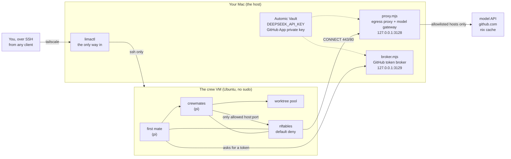
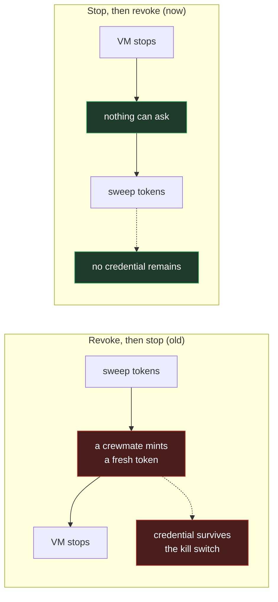
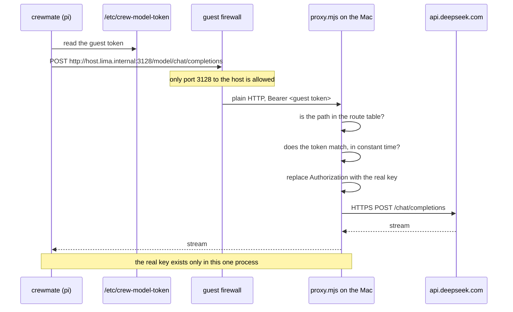
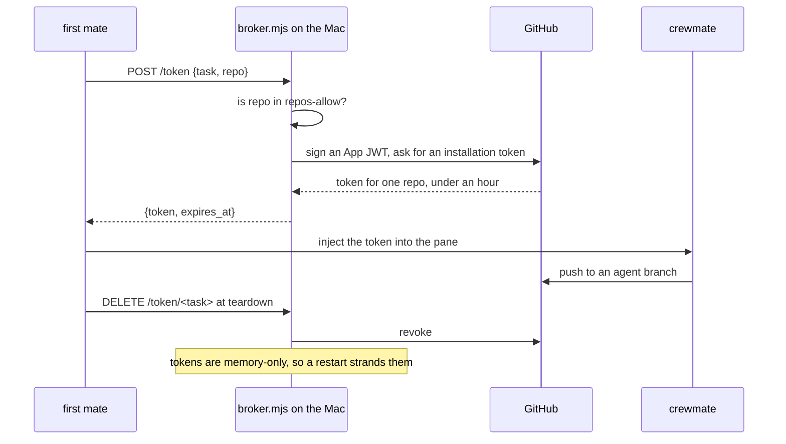
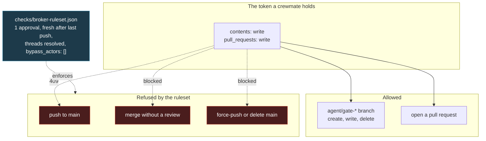

# How the crew sandbox works, and why each piece is there

A walkthrough of the code in [`nix/crew-sandbox/`](nix/crew-sandbox), written to be read
before the next phase. The review of what is missing is in
[crew-sandbox-review.md](crew-sandbox-review.md); this file explains what exists.

Terms are defined in [GLOSSARY.md](GLOSSARY.md).

---

## The problem, in plain words

Right now an agent that runs a task runs as you. It can read your files, use your GitHub
login, and open any connection your machine can open. A single line of malicious text in an
issue it is asked to fix is enough to turn it into something that copies your work somewhere
else or pushes to a branch you did not want.

Worktrees do not help here. A worktree separates two tasks' files from each other. It does
not separate either task from you.

So the machine gets a fence around it: one small Linux machine inside your Mac, holding all
the agents, with three things true.

1. It cannot see your files.
2. It cannot reach the internet, except through one door that you control.
3. It has no real passwords, keys or GitHub logins of its own.

The Mac keeps the keys. The little machine does the work. Nothing crosses back.

---

## The shape



Three things to notice:

- **The arrows that leave the guest are thin on purpose.** One port on the host, and that
  port decides everything else.
- **The keys never enter the guest box.** Both services that hold a key sit on the Mac side.
- **There is no arrow from the host into the guest's files.** Lima gives an SSH channel, and
  nothing else. No shared folder exists to be abused.

---

## The four pieces, and the code that makes each one true

### 1. The fence itself

> **/bro:** Your Mac has a home folder. Lima, out of the box, shares that folder with the little
> machine. Turning the share off is the most important line in the whole file. It is the
> difference between the agent _cannot_ see your files and the agent _promises not_ to look.

[`lima.yaml`](nix/crew-sandbox/lima.yaml) is the whole definition of the small machine.
It is short because most of the security is in what it _omits_.

```yaml
mounts: []
portForwards: []

ssh:
  localPort: 0
  loadDotSSHPubKeys: true
  forwardAgent: false
  forwardX11: false
```

**Why this matters.** Lima's default is to mount your home directory into the guest. That
one line would undo everything else: a shared folder means the agent reads your files, and a
shared _writable_ folder means it can plant a git hook or a symlink that your Mac later
follows. `mounts: []` is the difference between a fence and a window.

`forwardAgent: false` is the same idea for SSH. Without it, an agent inside the guest could
use your SSH key to log in as you somewhere else, and never touch a file to do it.

`loadDotSSHPubKeys: true` with `localPort: 0` means: let me in with my public key, on a
random local port, and nothing more.

The image is pinned by digest rather than by tag, so rebuilding the machine runs the exact
bytes this file names:

```yaml
images:
  - location: "https://cloud-images.ubuntu.com/releases/26.04/release/ubuntu-26.04-server-cloudimg-arm64.img"
    digest: "sha256:cf3b8472b84e7de37cdc2d2e9a9bf82b3edf0ab97113a1422eff048f26688e2f"
```

**Why.** A tag like `26.04` points at whatever was uploaded most recently. A digest points at
one file. If the mirror is compromised, a rebuild fails instead of quietly installing
something else.

### 2. Two users, and only one of them is privileged

> **/bro:** There are two logins inside the little machine. One is the admin, used only to set the
> machine up. The other is the worker, and it has no way to become the admin. If the agent
> cannot become root, it cannot change the firewall, install software, or read the other
> user's files.

The provision script creates `agent` without sudo:

```text
id -u agent >/dev/null 2>&1 || useradd --create-home --shell /bin/bash agent
```

**Why a second user at all.** The `crew` account has to keep sudo, because Lima uses it to
provision and re-provision the machine. If agents ran as `crew`, they would have root, and
every other control here would be decoration. `agent` exists so that "the agent cannot become
root" is a fact about the system, not a promise.

The gate then proves it from the inside, as `agent`:

```bash
expect_fail "sudo is unavailable" sudo -n true
expect_fail "the firewall cannot be flushed" nft flush ruleset
expect_fail "the firewall configuration is not writable" test -w /etc/nftables.conf
```

**Why these three.** They are the three ways out of a "no sudo" rule: become root, rewrite
the rules, or edit the rules file. Each check asks the guest to actually _do_ the thing and
counts a failure as a pass. That is deliberate — it survives someone re-enabling sudo later,
which a check for `! command -v sudo` would not.

### 3. The one door out

> **/bro:** The little machine is not allowed to talk to the internet. There is exactly one exception:
> one port on your Mac. Everything has to go through it, and it keeps a short list of where
> you are allowed to go. If a place is not on the list, it says no.

The firewall drops everything except one port on the host:

```text
chain output {
  type filter hook output priority filter; policy drop;
  oif lo accept
  ct state established,related accept
  # 3128 is the egress proxy, 3129 the token broker.
  ip daddr $gw tcp dport 3128 accept
  ip daddr $gw tcp dport 3129 accept
}
```

**Why default drop and not default allow with blocks.** A blocklist has to name everything
bad, which is impossible. A default drop has to name everything good, which is a short list
you can read. DNS is _not_ excepted, and that is the point: a resolver you can reach is a
covert channel, because data fits in a hostname. If the guest cannot resolve anything, it
cannot whisper out through a lookup.

`$subnet` and `$gw` are read at boot from the live interface, so a change to the network
cannot leave the rules pointing at a port that no longer exists.

**Why the file is root-owned.** The ruleset lives in `/etc/nftables.conf`, owned by root and
readable but not writable by `agent`. Loading a ruleset needs root. So there is no path from
`agent` to a changed firewall.

The proxy then decides what the one door reaches:

```js
const isAllowedHost = (hostname) => {
  const host = hostname.toLowerCase().replace(/\.$/, "");
  return rules.some((rule) =>
    rule.startsWith(".")
      ? host === rule.slice(1) || host.endsWith(rule)
      : host === rule,
  );
};

// Two ports, because that is all a package manager or a git remote ever needs.
const isAllowedPort = (portNumber) => portNumber === 443 || portNumber === 80;
```

**Why a dot means "and everything under it".** `.nixos.org` matches `cache.nixos.org` and
`releases.nixos.org`, because that is how a domain is used in practice. A bare name matches
exactly, so `github.com` does not silently allow `evil-github.com`. The `.endsWith(rule)`
test keeps the leading dot, so `notgithub.com` cannot pass as a subdomain of `github.com`.

**Why only 80 and 443.** Every real dependency here is a web request or a git remote. Anything
else is a service the guest has no business talking to, and refusing the port means a
compromised agent cannot reach a database or a mail server on an allowed host.

### 4. The model key stays home

> **/bro:** The agent needs to ask an AI model questions, and that costs money with your key. So the
> agent gets a fake key that only works on your own Mac. Your Mac checks the fake key, throws
> it away, and puts the real one on the request at the last second. The agent never sees the
> real one, so it cannot copy it out.

This is the piece that changed from the plan, and the change is an improvement worth
understanding.

The plan proposed a proxy that would break open TLS, read the request, and put the real key
in. That works, but it means running a certificate authority and trusting it inside the guest.

The code does something simpler. `pi` can point a built-in provider at a different address:

```json
{
  "providers": {
    "deepseek": {
      "baseUrl": "http://host.lima.internal:3128/model",
      "apiKey": "!cat /etc/crew-model-token"
    }
  }
}
```

**Why this is better.** The guest never uses TLS to talk to the gateway, so there is no
certificate to forge and no CA to distribute. It asks plain HTTP on the host's own port, and
the proxy is the only thing that ever speaks TLS to DeepSeek. One less moving part, and one
less thing to get wrong.

The `apiKey` line is a shell command rather than a literal, so `pi` reads a token that exists
only inside the guest. That token is not the model key. It is a random 32-byte value created
inside the VM:

```text
if [ ! -s /etc/crew-model-token ]; then
  printf '%s' "$(openssl rand -hex 32)" >/etc/crew-model-token
  chown root:root /etc/crew-model-token
  chmod 0644 /etc/crew-model-token
fi
```

**Why the token is world-readable.** Because `pi` runs as `agent` and has to read it. It is
readable on purpose, and it is only useful against the host gateway. The value that is _not_
readable is the real key, which never leaves the Mac.

The gateway swaps the header and refuses everything else:

```js
const modelRoutes = new Map([
  ["GET /models", "/models"],
  ["POST /chat/completions", "/chat/completions"],
]);

const tokenMatches = (header) => {
  if (
    !modelToken ||
    typeof header !== "string" ||
    !header.startsWith("Bearer ")
  )
    return false;
  const given = Buffer.from(header.slice("Bearer ".length));
  const expected = Buffer.from(modelToken);
  return (
    given.length === expected.length && crypto.timingSafeEqual(given, expected)
  );
};
```

**Why an explicit route table.** If the gateway forwarded any path, a compromised guest could
use the host's key against any DeepSeek endpoint, including ones that cost money or change
account settings. Two routes is the whole model API that `pi` uses. Everything else gets a
`404`.

**Why `timingSafeEqual`.** A plain string comparison returns as soon as it finds a difference,
and the time it takes leaks how much of the token was right. `timingSafeEqual` takes the same
time either way, so the token cannot be guessed one character at a time.

The proxy refuses to serve at all unless both halves are present:

```js
const modelKey = process.env.DEEPSEEK_API_KEY;
const modelToken = process.env.CREW_MODEL_TOKEN;
const modelReady = Boolean(modelKey && modelToken);
```

**Why fail closed.** A gateway that runs without a key would pass requests through
unauthenticated. A gateway that runs without a token would accept anyone's request and attach
the real key. Requiring both means a half-configured proxy is _off_, not open.

### 5. GitHub access without a GitHub login

> **/bro:** Same idea again. Instead of giving the agent your GitHub login, your Mac hands it a
> temporary pass that works on one repository and stops working within the hour. When the
> task finishes, the pass is cancelled. If the agent goes bad, it has one repo and a few
> minutes, not your whole account.

A crewmate never has a token of its own. It asks the broker, which mints one for a single
repository:

```js
const mint = async (repo) => {
  const id = await installationId();
  const { status, payload } = await api(`/app/installations/${id}/access_tokens`, {
    method: "POST",
    body: JSON.stringify({
      repositories: [repo],
      permissions: { contents: "write", pull_requests: "write" },
    }),
  });
  ...
  return { token: payload.token, expires_at: payload.expires_at };
};
```

**Why an App installation token and not a personal token.** A personal token carries your
whole account: every repository you can see. An installation token is created fresh, names
one repository, carries two permissions, and expires within the hour. If an agent is
compromised, the attacker gets one repository for less than an hour — not your account.

**Why the allowlist on top.** GitHub already refuses a token outside the App's installation.
`repos-allow` is the second lock, so a task cannot ask for a different project than the one it
is working on even if both are installed. Two locks, because the first one depends on how the
App was installed, which is a setting you can change by accident.

The signing is done by hand so it can be tested without the network:

```js
const appJwt = () => {
  const now = Math.floor(Date.now() / 1000);
  const header = base64url(JSON.stringify({ alg: "RS256", typ: "JWT" }));
  const payload = base64url(
    JSON.stringify({ iat: now - 60, exp: now + 540, iss: appId }),
  );
  const signature = crypto
    .createSign("RSA-SHA256")
    .update(`${header}.${payload}`)
    .sign(privateKey);
  return `${header}.${payload}.${base64url(signature)}`;
};
```

**Why the clock is set back a minute.** GitHub rejects a token whose `iat` is in the future,
and machines drift. A minute of slack costs nothing and removes a class of intermittent
failure that is very hard to diagnose. Nine minutes of life is under GitHub's ten-minute cap.

`--selftest` then signs and verifies with the public half of the same key, so a wrong or
mangled key fails on the Mac instead of as a confusing `401` from GitHub later.

**Why tokens live only in memory.** A restart loses every token. That is the safe direction:
the broker cannot hand out a token it has forgotten, so a crash narrows access rather than
widening it. `/revoke-all` makes the same thing deliberate.

**Why the kill switch stops the VM before it revokes.** The broker is still unauthenticated
(see C1 in [crew-sandbox-review.md](crew-sandbox-review.md)), so any crewmate can ask for a token at any moment.
Revoking first would leave a gap: a token minted just after the sweep would survive it, and
`kill` would report success while a live credential remained. Stopping the VM first means
nothing can ask, so the revoke sweeps a set that can no longer grow.



The command also survives a failed stop. `writeShellApplication` turns on `errexit`, so an
unguarded `limactl stop` failure would abort the script _before_ the revoke — the exact
opposite of what a kill switch is for. The failure is caught, reported, the revoke still
runs, and the command exits non-zero, because either half alone leaves a credential alive.

### 6. The gates

> **/bro:** A gate does not read the config file and say 'looks right.' It logs in as the worker and
> actually tries to break out. If the worker succeeds, the gate fails. That is the only kind
> of check that still works after somebody has changed the machine by hand.

Each gate runs from the side that could abuse the boundary. `checks/agent.sh` runs as `agent`
and tries to escape. `checks/root.sh` runs as root and inspects what `agent` cannot see.

```bash
expect_fail() {
  local label=$1
  shift
  if "$@" >/dev/null 2>&1; then
    flunk "$label"
  else
    pass "$label"
  fi
}
```

**Why "expect the command to fail" rather than "read a setting".** A setting can be true in
the file and false on the machine. Asking the guest to do the forbidden thing tests the
machine as it is right now, after every change anyone made by hand. That is the only thing
worth gating on.

`check.sh` splits the work by privilege because the two halves need different users:

```bash
limactl shell "$name" -- sudo -n -u agent -H bash /tmp/crew-agent-checks.sh || status=1
limactl shell "$name" -- sudo -n bash /tmp/crew-root-checks.sh || status=1
```

**Why `-H`.** It points `HOME` at the agent's real home. Without it, `sudo -u` leaves `HOME`
as root's, and every check would inspect the wrong directory and pass for the wrong reason.

---

## What happens when an agent asks the model a question



The two things that make this safe are at the middle: the guest's token is checked, and the
header is _replaced_ rather than forwarded. An agent that sends its own `Authorization`
header gets it thrown away.

---

## What happens when a task needs to push



**Why the first mate asks and the crewmate does not.** The first mate is the one that knows
which repository a task belongs to. A crewmate that could ask for itself could ask for
anything on the list. Today this is a design intention rather than an enforced rule — see
finding C1 in [crew-sandbox-review.md](crew-sandbox-review.md), which is the single most important thing to fix before
Phase 4.

### What stops a task merging its own work

A scoped token is not enough on its own. The token can write `contents`, and a writer that
can reach the default branch can merge the pull request it just opened, so the review step
would be decoration. The ruleset is what makes review real.



**Why `bypass_actors` must stay empty.** GitHub lets a ruleset name actors that skip its
rules. If the App were on that list, every rule above would still read as "enforced" while
the token walked straight through. The gate checks the effective rules on the branch, not the
ruleset file, so a bypass added later fails the gate.

**Why the gate writes to an `agent/` branch now.** The old probe wrote to the default branch
and deleted the file afterwards. That call only succeeds when nothing protects `main`, so the
gate passed _because_ the backstop was missing — the test proved the opposite of the plan.
It now asserts both halves: the token **can** write an agent branch, and the default branch
**refuses** the same token.

---

## Where everything lives

| Path                                                                          | What it is                                                                                              |
| ----------------------------------------------------------------------------- | ------------------------------------------------------------------------------------------------------- |
| [`lima.yaml`](nix/crew-sandbox/lima.yaml)                                     | the guest: image digest, no mounts, two users, firewall, proxy env                                      |
| [`default.nix`](nix/crew-sandbox/default.nix)                                 | builds the `crew-sandbox` CLI and the `crew-sandbox-check` gate                                         |
| [`crew-sandbox.sh`](nix/crew-sandbox/crew-sandbox.sh)                         | the operator's commands: `up`, `down`, `destroy`, `kill`, `status`, `shell`, `check`, `proxy`, `broker` |
| [`proxy.mjs`](nix/crew-sandbox/proxy.mjs)                                     | CONNECT proxy with an allowlist, plus the `/model` gateway                                              |
| [`egress-allow`](nix/crew-sandbox/egress-allow)                               | the hostnames the proxy will reach                                                                      |
| [`broker/broker.mjs`](nix/crew-sandbox/broker/broker.mjs)                     | per-task GitHub App tokens, in memory, revocable                                                        |
| [`checks/broker-ruleset.json`](nix/crew-sandbox/checks/broker-ruleset.json)   | the human-merge backstop: review required, App not exempt                                               |
| [`repos-allow`](nix/crew-sandbox/repos-allow)                                 | the repositories a task may ask for                                                                     |
| [`guest/models.json`](nix/crew-sandbox/guest/models.json)                     | points `pi` at the gateway                                                                              |
| [`guest.nix`](nix/crew-sandbox/guest.nix)                                     | the guest's home-manager module: `pi` and the crew tools                                                |
| [`check.sh`](nix/crew-sandbox/check.sh), [`checks/`](nix/crew-sandbox/checks) | the phase gates                                                                                         |

---

## How to check it yourself

```sh
nix run .#crew-sandbox -- up               # create on first use, then start
nix run .#crew-sandbox -- check            # phase 1: the box
nix run .#crew-sandbox -- check toolchain  # phase 2: the tools
nix run .#crew-sandbox -- check proxy      # phase 3a: the allowlist
nix run .#crew-sandbox -- check model      # phase 3a-2: the key stays home
nix run .#crew-sandbox -- check broker     # phase 3b: one repo, one token, revocable
nix run .#crew-sandbox -- ruleset <repo>   # apply the human-merge backstop (idempotent)
```

`check model` and `check broker` need the vault, so they prompt for approval. Both start and
stop their own service, which is why `check model` refuses to run while another proxy holds
port 3128 — it needs to control the key for the duration of the gate.

To see the boundary from the inside, which is the interesting direction:

```sh
nix run .#crew-sandbox -- shell
sudo -u agent -H bash -lc 'curl -sS https://example.com'   # fails: no egress
sudo -u agent -H bash -lc 'sudo -n true'                   # fails: no root
ls /Users                                                  # fails: no host filesystem
```

---

## What is not there yet

Stated plainly, because the gates currently pass while these are true:

- **The Mac is not ready to be headless.** Nothing sets never-sleep or restart-after-power-
  failure, so Phase 0's own test — pull the power, come back, reach it — has never been run.
- **The fleet is not in the guest.** `herdr` is not installed, there is no git identity, and
  `~/agentic-dev-env` in the guest is not a git repository. Phase 4 has not started.
- **The GitHub API is not reachable.** `api.github.com` is missing from `egress-allow`, so
  `gh-axi` and `no-mistakes` cannot work in the guest even though `git clone` does.
- **The broker is open.** Any crewmate can ask it for a token, because it checks no
  credential. The port is even opened in the firewall on purpose.
- **No red-team run exists.** Phase 5 is a plan, not a script.

The review in [crew-sandbox-review.md](crew-sandbox-review.md) lists each of these
with the evidence and the fix, ordered by effect per unit of work.
